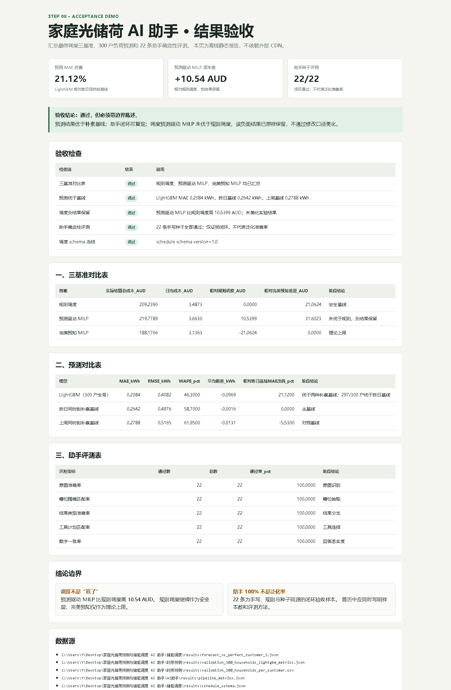

# 家庭光储荷预测与储能调度 AI 助手

一个基于 Ausgrid 悉尼 300 户家庭、3 年半小时数据的端到端项目，覆盖数据工程、EDA、时序预测、储能调度、AI 助手、FastAPI 服务、Docker 和 TFLite 边缘部署。



## 项目要解决什么

项目把家庭能源问题串成一条可验收链路：


## 核心结果

### 300 户负荷预测

3 折扩展窗口 walk-forward，共 864,000 个半小时评估点。

| 模型 | MAE (kWh) | RMSE (kWh) | WAPE | 说明 |
| --- | ---: | ---: | ---: | --- |
| LightGBM 全局模型 | **0.2084** | **0.4082** | 46.30% | 优于两种朴素基线 |
| 昨日同时刻基线 | 0.2642 | 0.4976 | 58.70% | 主基线 |
| 上周同时刻基线 | 0.2788 | 0.5165 | 61.95% | 对照基线 |

LightGBM 相对昨日基线 MAE 改善约 **21.12%**，300 户中有 **297 户**优于昨日同时刻基线。

### 储能调度三基准

Customer 1，60 天预测驱动实际结算：

| 策略 | 实际结算成本 | 相对完美预知 |
| --- | ---: | ---: |
| 规则调度 | 209.24 AUD | +21.06 AUD |
| 预测驱动 MILP | 219.78 AUD | +31.60 AUD |
| 完美预知 MILP | 188.18 AUD | 0 |

预测驱动 MILP 没有优于规则调度。这是一个保留在项目中的负结果：预测误差会使确定性 MILP 产生额外 regret，因此规则调度被保留为安全层，而不是通过修改评价口径美化结果。

### AI 助手

- 14 类意图、10 个只读工具、3 类用户范围
- 默认使用规则意图识别、工具调用、模板回答和数字一致性检查
- 不配置外部 API 也能完成端到端闭环
- 22 条手写种子评测全部通过

22/22 仅用于验证契约闭环、错误处理和数字忠实度，不代表泛化准确率。

## 一条命令生成验收报告

```powershell
Set-Location "八结果demo与验收"; python build_acceptance.py --open
```

生成：

- `three_strategy_comparison.csv`
- `forecast_comparison.csv`
- `assistant_evaluation.csv`
- `acceptance_report.html`
- `acceptance_summary.json`

报告完全离线，不依赖外部 CDN。

## 快速运行

### FastAPI 工具服务

```powershell
Set-Location "AI助手"
python -m pip install -r requirements.txt
python -m uvicorn api:app --host 127.0.0.1 --port 8765
```

### 服务与 SQLite 请求日志

```powershell
Set-Location "服务与数据库"
python -m uvicorn service_api:app --host 127.0.0.1 --port 8766
```

### Docker 边缘服务

```powershell
Set-Location "边缘部署与工程化"
docker build -t home-energy-edge:latest .
docker run --rm -p 8000:8000 home-energy-edge:latest
```

本地文档使用随项目分发的 Swagger UI，不依赖外部 CDN。

### TFLite 对比

```powershell
Set-Location "边缘部署与工程化"
python tflite_benchmark.py
```

当前小模型：

- Keras：28.35 KiB
- TFLite Float32：2.95 KiB
- 转换最大绝对误差：7.15e-7 kWh

该模型是边缘部署样例，不替代主 LightGBM 预测模型。

## 目录

| 目录 | 职责 |
| --- | --- |
| `数据格式与校验/` | CSV 读取、规则校验、长表转换、数据质量报告 |
| `EDA探索性数据分析/` | 日负荷、季节曲线、300 户对比、用户聚类 |
| `时序预测/` | 季节朴素基线、LightGBM、300 户 walk-forward |
| `储能调度/` | 电池模型、规则调度、MILP、稳健回退 |
| `AI助手/` | 意图/工具契约、规则基线、数字检查、评测 |
| `服务与数据库/` | FastAPI 包装与 SQLite 请求日志 |
| `边缘部署与工程化/` | Pytest、Actions、Docker、TFLite |
| `八结果demo与验收/` | 三张验收表与离线 HTML 报告 |

## 工程要点

- 严格区分 30 分钟累计电量 kWh 和瞬时功率 kW
- 处理三年不统一日期格式、GC/CL/GG 类别和夏令时边界
- 预测使用扩展窗口 walk-forward，不做随机时间切分
- 调度同时约束充放电互斥、购售电互斥和日末 SOC
- AI 回答中的数字必须来自工具返回，并通过程序化一致性检查
- 使用 Pydantic 冻结工具输入输出和错误码
- 测试覆盖数据契约、工具数字一致性、API、日志和 TFLite 制品

## 已知局限

- 调度优化主要验证 Customer 1，不是 300 户生产级调度平台
- 预测驱动 MILP 输给规则调度，结论没有被隐藏
- AI 助手的主力是确定性规则闭环，DeepSeek 只是可选组件
- 22 条评测样本不能证明泛化能力
- SQLite 日志接口没有生产级鉴权
- Docker 镜像仍有继续瘦身空间
- TFLite 模型是工程演示，不是主预测精度方案

## 数据与许可

原始 Ausgrid 数据未提交到仓库，来源、许可和放置方式见 [DATA_SOURCE.md](DATA_SOURCE.md)。

代码使用 [MIT License](LICENSE)。

## 测试

各模块采用 Pytest 或 unittest。完整预测和调度测试需要先按 `DATA_SOURCE.md` 准备原始数据。

边缘模块可在无 TensorFlow 的环境中运行轻量测试：

```powershell
Set-Location "边缘部署与工程化"
python -m pytest -q -m "not tflite"
```

仓库中的 GitHub Actions 会额外运行一次合成数据 TFLite 冒烟测试。
